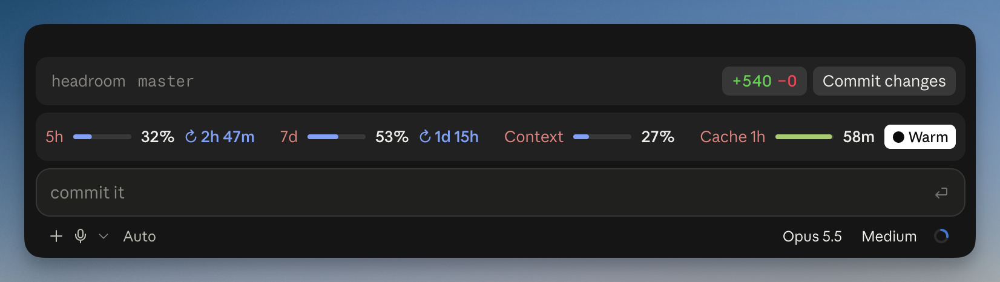

# Headroom

A Claude Code mod that puts your plan usage, context and prompt-cache state in one row above the prompt, and can keep the cache warm while you're away.



## Features

- **Usage meters:** the 5-hour and 7-day windows, with the time until each resets. Bars turn yellow at 70% and red at 90%.
- **Context meter:** how full the context window is. Yellow at 70%, red at 85%.
- **Cache countdown:** how long the prompt cache stays warm after the last reply, using the same TTL rule as Claude Code (see below). Shows `Live` during a reply and `Expired` once it lapses.
- **Keep warm:** refreshes the cache at 90% of its lifetime with a tiny hidden request that reuses your conversation, so your next message hits the cache instead of resending the whole context. Toggle it with the **Warm** button or `/keep-warm`. It turns on by itself once the context passes 100k tokens, and stops 3 hours after your last message.
- **Warnings:** a toast at 80% and 95% of a usage window and when a turn misses the cache, plus a desktop notification a few minutes before an idle cache expires.

## Install

In a Claude Code terminal session:

```
/plugin install headroom --marketplace diazkev314/headroom
```

Answer `y` to add the marketplace, then pick a scope. Installed at user scope, it also loads in the desktop app's Code tab.

In the terminal, the reset icon needs a [Nerd Font](https://www.nerdfonts.com/) (Ghostty bundles one), and the bars use a block character that Ghostty, Kitty and WezTerm draw themselves; elsewhere both depend on your font, and a missing glyph shows as an empty box.

## Options

Set them on the options screen during install, later with `/config` in a terminal session (each option is a row), or under `pluginConfigs` in `settings.json`.

| Option | Default | What it does |
| --- | --- | --- |
| `cacheTtl` | `auto` | `auto` follows Claude Code's rule; `5m` or `1h` forces one |
| `keepWarmHours` | `3` | How long keep-warm keeps refreshing after your last message |
| `autoKeepWarmTokens` | `100000` | Context size at which keep-warm turns on by itself; `0` disables |
| `warnings` | `true` | Usage, cache-miss and expiry warnings |

## How the cache TTL is chosen

Claude Code doesn't expose the TTL to mods, so `auto` mirrors its own rule for the main conversation (read from Claude Code 2.1.294):

1. `FORCE_PROMPT_CACHING_5M` set: 5 minutes.
2. `CLAUDE_CODE_PROMPT_CACHE_TTL`, or `promptCacheTtl` in settings: that value.
3. `ENABLE_PROMPT_CACHING_1H` set: 1 hour.
4. A Pro/Max subscription within its plan limits: 1 hour.
5. An API key, or extra usage past the plan limit: 5 minutes.

## Cost of keep-warm

Each refresh reads your context from the cache at about 10% of the normal input cost, and counts toward your usage limit. A miss on a 1-hour cache re-writes the whole context at about 2×. So keep-warm pays off whenever you come back before it stops, and costs at most a few refreshes if you don't.

## Development

```
claude plugin validate .
claude plugin test .
claude --plugin-dir .
```

`tsconfig.json` extends the types Claude Code writes to `.claude-plugin/types/` when it loads the mod; run it once with `--plugin-dir` before type-checking with `tsc -p .`.

## License

MIT
